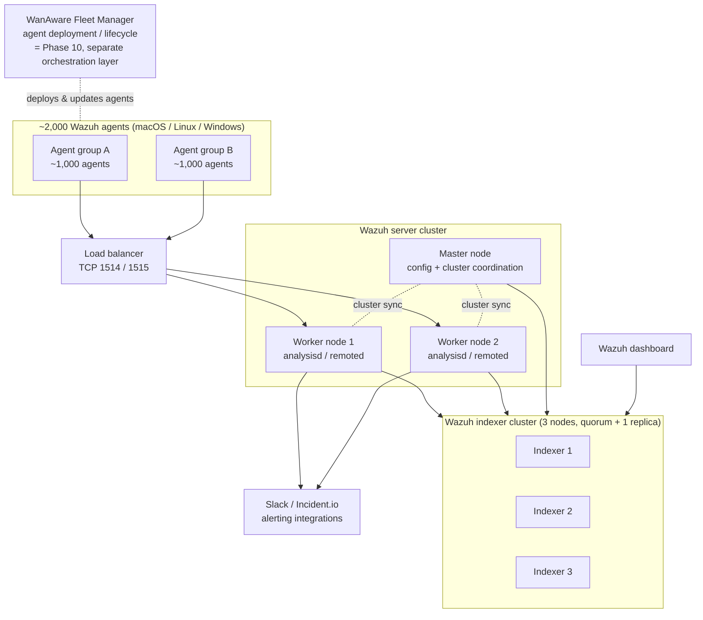

# Wazuh POC — Phase 3: Scalability, Architecture & Cost Analysis

**Prepared by:** WanAware Security Team
**Phase:** 3 (Scalability, architecture & cost research) — desk research, no live stack required
**Platform:** Wazuh v4.14.x (XDR/SIEM)
**Target scale:** up to 2,000 deployed agents
**Date:** July 2026
**Status:** Draft for management review

> **Read this first.** The infrastructure figures below are an **endpoint-only baseline**. They cover 2,000 Wazuh *agents* and their telemetry. They do **not** yet include GCP and NinjaOne SIEM log ingestion (Phase 7), which the POC has repeatedly flagged as the single largest unmeasured variable. Expect the storage line — and possibly the indexer node count — to rise once those sources are connected and measured. Every number here is a planning estimate with its assumptions stated; none is a quote.

---

## 1. Executive summary

- Wazuh at 2,000 agents requires a **distributed, multi-node cluster** — the all-in-one deployment used in the POC tops out at ~100 agents. This is a well-supported, standard Wazuh configuration, not an edge case.
- The recommended production topology is a **7-node cluster**: 1 Wazuh server master + 2 server workers (agents split across them behind a load balancer) + 3 indexer nodes (data + high availability) + 1 dashboard.
- **Wazuh software licensing is $0** (open source, GPLv2 / Apache 2.0). This is the headline cost difference versus CrowdStrike's per-endpoint subscription. It does **not** mean Wazuh is free to run.
- **The dominant cost of a self-managed Wazuh deployment is operational labor, not infrastructure.** Infrastructure lands at roughly **$16k–$31k/year** on GCP depending on commitment level and HA choices; the staff time to run, tune, and upgrade it plausibly **exceeds** that. Management should weigh the decision on total cost of ownership, not the license line.
- Three deployment models are viable and are compared below: **self-hosted on-premises**, **self-managed on GCP**, and **Wazuh Cloud (SaaS)**. Each trades capital cost, operational labor, and elasticity differently.

---

## 2. Recommended production architecture (2,000 agents)

### 2.1 Topology

Wazuh's own guidance is explicit: the single-host deployment is sufficient only up to ~100 endpoints, and larger environments should move to a distributed deployment with multi-node clustering available independently for the Wazuh server and the Wazuh indexer. At 2,000 agents we are firmly in distributed territory.

If the diagram above does not render, the topology is: agents connect through a **load balancer** to **two server worker nodes** (~1,000 agents each); a **master node** coordinates cluster state and configuration; all server nodes forward alerts to a **3-node indexer cluster** that stores and indexes the data with one replica for HA; a **dashboard** reads from the indexer cluster; and alerting integrations (Slack, Incident.io) fire from the server side.

### 2.2 A note on "Fleet Manager"

The RFP phrase "Wazuh Fleet Manager worker nodes" merges two distinct things this document keeps separate:

- **Wazuh server-cluster worker nodes** — the compute tier in the diagram above that agents connect to and that runs `analysisd`/`remoted`. This is what the sizing and cost below cover.
- **WanAware Fleet Manager** — the internal orchestration/deployment tooling used to push, update, and retire the agent software across endpoints at scale. That integration is **Phase 10** and is currently blocked on internal access. It is an *agent-lifecycle* concern layered on top of the cluster, not part of the cluster's compute sizing.

Keeping these separate matters for cost: cluster sizing scales with telemetry volume; Fleet Manager effort scales with endpoint count and rollout cadence.

### 2.3 Node roles and starting-point sizing

| Role | Count | vCPU | RAM | Storage | Purpose |
|:----|:----|:----|:----|:----|:----|
| Server — master | 1 | 4 | 16 GB | ~50 GB SSD | Cluster coordination, centralized config, ruleset distribution |
| Server — worker | 2 | 8 | 32 GB | ~50 GB SSD each | Agent connections + event analysis (~1,000 agents each) |
| Indexer | 3 | 8 | 32 GB | ~1.3 TB SSD each | Store/index alerts; quorum (3 nodes) + 1 replica for HA |
| Dashboard | 1 | 4 | 16 GB | ~50 GB SSD | Visualization, investigation, reporting |

**Sizing caveats (important — these are starting points, not validated ceilings):**

- Wazuh does **not** publish a hard "agents per node" number. Capacity is driven by **events per second (EPS)**, which depends on which modules are enabled. Your POC runs a security-instrumented baseline (osquery + Vulnerability Detector + FIM), which is heavier than a stock agent. The ~1,000-agents-per-worker split is a conservative planning figure and **must be validated under real load** before it is trusted for production.
- The indexer nodes carry the RAM requirement because of the JVM heap (heap is capped at roughly half of RAM and ~32 GB max); 32 GB/node is a sound production indexer size. Scale the indexer tier by **adding nodes**, not just enlarging them.
- Storage per indexer node (~1.3 TB) derives from the POC's measured ~3.75 TB 90-day working set split across 3 nodes. See §4 for the full storage derivation and the replica sensitivity.

---

## 3. Scalability and known constraints

These are the constraints management should be aware of before committing to production scale. Several come directly from the POC's own findings.

1. **The server tier scales horizontally, not vertically.** The agent-connection/event-reception daemon (`remoted`) does not benefit indefinitely from bigger nodes; the supported path to more capacity is **more worker nodes**, not a larger single node. Budget for horizontal growth.
2. **The indexer tier is the storage and memory bottleneck.** Data volume and query load land here. Scale by adding indexer nodes; keep the JVM heap within the ~32 GB ceiling per node.
3. **No fixed EPS/agent ceiling exists.** Because capacity is EPS-driven and module-dependent, all node counts here are planning estimates. A load test at ~500 and ~1,000 agents per worker is the only way to confirm the split before production.
4. **The Vulnerability Detector CVE feed is a fixed ~8–8.5 GB per manager** (confirmed in POC Phase 5 — this is the RocksDB `vd/feed`, not osquery). This overhead is **per server node** and therefore multiplies with worker count. It is normal and must not be deleted, but it should be accounted for in per-node disk.
5. **GCP + NinjaOne log volume is unmeasured and is the dominant sizing unknown.** SIEM log ingestion (Phase 7) will add to both storage and ingest EPS. The endpoint-only baseline in this document will need upward revision once those sources are connected and measured.
6. **Per-agent data volume varies by platform.** The POC's ~20 MB/day/agent figure is a *security-instrumented macOS* measurement and is deliberately conservative/high. Linux and Windows agents will differ. A mixed fleet's true average should be measured before final provisioning.
7. **The master node is a coordination single point.** The cluster continues serving if the master is unavailable, but centralized configuration changes pause until it returns. For production, plan master recovery (snapshot/restore) as part of the runbook.

---

## 4. Cost analysis

### 4.1 Basis and assumptions

- **Region:** us-central1 (Iowa). Rates retrieved July 2026 and will drift; treat as a snapshot.
- **Storage working set:** POC-measured **~3.75 TB** for 90-day retention at 2,000 agents (endpoint-only, HA + headroom per the storage-retention doc). Replica sensitivity is called out separately below.
- **Licensing:** Wazuh software is **$0** (open source). No per-agent or per-node license fee.
- **Excluded from the baseline:** GCP/NinjaOne SIEM log volume (Phase 7, unmeasured).

### 4.2 GCP rate reference (us-central1, on-demand, July 2026)

| Resource | On-demand | 1-yr committed | 3-yr committed |
|:----|:----|:----|:----|
| n2-standard-8 (8 vCPU / 32 GB) | ~$283.58/mo | ~$178.65/mo (−37%) | ~$127.62/mo (−55%) |
| n2-standard-4 (4 vCPU / 16 GB) | ~$164.16/mo | ~$103/mo | ~$74/mo |
| e2-standard-4 (4 vCPU / 16 GB) | ~$98/mo | ~$62/mo | ~$44/mo |
| Persistent Disk — balanced (pd-balanced) | ~$0.10 / GB-mo | n/a | n/a |
| Persistent Disk — SSD (pd-ssd) | ~$0.17 / GB-mo | n/a | n/a |
| Cloud Storage — Coldline (backups/archive) | ~$0.007 / GB-mo | n/a | n/a |

Committed-use discounts apply to compute only. n2 instances also receive automatic sustained-use discounts (~20–30%) that are **not** stacked into the on-demand figures above, so real on-demand bills tend to run a little lower.

### 4.3 GCP monthly cost (endpoint-only baseline)

| Line item | Detail | On-demand /mo |
|:----|:----|:----|
| Server master | 1 × n2-standard-4 | $164 |
| Server workers | 2 × n2-standard-8 | $567 |
| Indexer nodes | 3 × n2-standard-8 | $851 |
| Dashboard | 1 × e2-standard-4 | $98 |
| Indexer storage | 3.75 TB × pd-balanced ($0.10) | $384 |
| Boot/OS disks | ~6 × 30 GB × $0.10 | $18 |
| Backups (snapshots → Coldline) | ~4 TB × $0.007 | $29 |
| Network / load balancer / egress | estimate | ~$70 |
| **Total (single-copy storage)** | | **~$2,180/mo** |

**Replica sensitivity:** adding a full indexer replica for HA (recommended for production) roughly doubles the indexer storage line (+~$384/mo), taking the total to **~$2,560/mo**. Whether the POC's 3.75 TB figure already includes replica should be confirmed against the storage-retention doc before finalizing.

### 4.4 Infrastructure TCO — 1-year and 3-year horizons

Infrastructure only (single-copy storage; add ~$4.6k/yr for a replica):

| Scenario | 1-year | 3-year |
|:----|:----|:----|
| GCP, on-demand | ~$26,000 | ~$78,000 |
| GCP, 1-yr committed-use | ~$19,000 | — |
| GCP, 3-yr committed-use | — | ~$45,000 |

### 4.5 Ranged estimates for the previously-unpriced items

Everything the first draft left as "quote required," "minor," or deferred is estimated below across a **Low / Mid / High** band. Read these as planning brackets, not quotes.

**(a) Operational labor** — the largest and most decision-relevant line for any self-run model. Loaded cost assumed ~$150k/yr per security-engineer FTE.

| Band | FTE | Annual | When it applies |
|:----|:----|:----|:----|
| Low | 0.25 | ~$37,500 | Stable, well-tuned, low change rate, single platform |
| Mid | 0.40 | ~$60,000 | Active tuning, SIEM sources being added, mixed fleet |
| High | 0.50–0.75 | ~$75,000–$112,000 | 2,000-agent scale, frequent upgrades, no managed help |

Under a managed/SaaS model this drops to ~0.1–0.2 FTE (~$15,000–$30,000) because the vendor runs the backend.

**(b) Self-hosted on-prem hardware capex** (7 VMs; amortize over 4 years):

| Band | Setup | Capex | Amortized + power/rack |
|:----|:----|:----|:----|
| Low | Reuse existing hypervisor capacity — VMs only | ~$0 incremental | ~$2,000/yr (power/rack share) |
| Mid | 2–3 new physical hosts to run the 7 VMs | ~$20,000–$30,000 | ~$7,000–$9,500/yr |
| High | Dedicated redundant cluster + DR site | ~$40,000–$60,000 | ~$12,000–$17,000/yr |

**(c) Wazuh Cloud (SaaS)** — Wazuh Cloud is **custom-quote only**; there is no public per-GB or per-agent list price, and it is priced by agent count, data volume, and support tier. The band below is *derived* (self-run infra + a typical managed-service margin of ~1.5–3×), not quoted — treat it as a placeholder until a real quote is obtained:

| Band | Derived annual subscription (2,000 agents) |
|:----|:----|
| Low | ~$45,000 |
| Mid | ~$65,000 |
| High | ~$95,000 |

**(d) CrowdStrike (incumbent EDR)** — public 2026 list pricing, per device/year: Falcon Go $59.99 (no EDR, capped at 100 devices — not applicable at this scale), Falcon Pro $99.99 (no full EDR), **Falcon Enterprise $184.99 (first tier with EDR/XDR — the apples-to-apples tier versus Wazuh)**, Falcon Complete managed MDR ~$15–25/endpoint/month (quote-based). Volume discounts at the 1,000–5,000-endpoint breakpoint run ~20–30% off list; server endpoints typically bill at 1.5–2× the workstation rate.

For **2,000 endpoints at the EDR-relevant Enterprise tier**:

| Band | Basis | Annual |
|:----|:----|:----|
| Low | Enterprise list less ~30% volume discount | ~$260,000 |
| Mid | Enterprise less ~20% discount + Express Support | ~$300,000 |
| High | Enterprise at list, blended for some servers | ~$370,000–$400,000 |
| (Managed) | Falcon Complete MDR, 2,000 endpoints | ~$360,000–$600,000 |

> **These are public list prices, not WanAware's rate.** Actual contracted pricing is negotiated below list and must be confirmed with procurement before Phase 11. They are included here for planning scale only. This is a *different act* from asserting a single verified competitor figure — the range is explicitly labeled as unverified public list.

### 4.6 Consolidated all-in TCO comparison (annual)

Combining infrastructure/subscription + operational labor + license. All figures annual, Low/Mid/High.

| Model | Infra / subscription | Labor | License | All-in Low | All-in Mid | All-in High |
|:----|:----|:----|:----|:----|:----|:----|
| **Self-hosted on-prem** | $2k–$17k | $37.5k–$112k | $0 | **~$40,000** | **~$70,000** | **~$130,000** |
| **Self-managed on GCP** | $16k–$31k | $37.5k–$112k | $0 | **~$54,000** | **~$80,000** | **~$143,000** |
| **Wazuh Cloud (SaaS)** | $45k–$95k | $15k–$30k | incl. | **~$60,000** | **~$95,000** | **~$125,000** |
| **CrowdStrike (Enterprise)** | $260k–$400k | ~$22k–$37k | incl. | **~$285,000** | **~$340,000** | **~$435,000** |

**How to read this.** All three Wazuh models land in the **~$40k–$145k/yr** all-in band; CrowdStrike Enterprise lands **~$285k–$435k/yr**. The gross TCO advantage is roughly **3–7×** in Wazuh's favor, driven almost entirely by the $0 license. But cost cannot be read in isolation: the POC's own EDR findings documented real capability gaps on macOS (no realtime FIM, no process telemetry without osquery + EndpointSecurity + an MDM-pushed PPPC profile per endpoint, userland-only agent versus CrowdStrike's ESF-based sensor). A fair go/no-go weighs the ~3–7× cost saving against those gaps and the self-run operational burden — it does not present the cost number alone.

---

## 5. Open variables to close before production sign-off

1. **GCP + NinjaOne log volume (Phase 7)** — dominant unknown; will revise storage and possibly indexer count upward.
2. **Load validation of the agents-per-worker split** — confirm ~1,000/worker under real EPS before trusting the 2-worker topology.
3. **Mixed-fleet per-agent data average** — measure Linux/Windows alongside the macOS ~20 MB/day figure.
4. **Replica decision** — confirm whether 3.75 TB includes a replica; it materially changes storage cost.
5. **CrowdStrike contracted pricing** — §4.5(d) uses public list ranges; obtain WanAware's actual contracted rate from procurement to replace them before Phase 11.
6. **Wazuh Cloud quote** — §4.5(c) uses a derived band; request a real quote if the SaaS model is in genuine contention.
7. **macOS EDR capability gaps** — the cost advantage in §4.6 must be read against the Phase 2 EDR findings; carry both into the go/no-go.

---

## 6. Recommendation (architecture & cost)

For 2,000 agents, deploy the **7-node distributed cluster** in §2 (1 master + 2 workers + 3 indexers + 1 dashboard) with a load balancer for agent connections and a replica on the indexer tier for HA. Target **GCP with a 1-year committed-use discount** as the production home once the change request clears, using the on-prem Linux box as an interim staging host in the meantime.

On the numbers: infrastructure runs **~$19k/year (1-yr CUD, single copy)** to **~$31k/year (on-demand + replica)**, but the **all-in TCO of ~$54k–$143k/year** (§4.6) is the figure to plan against, because operational labor is the larger line. Against CrowdStrike Enterprise at a benchmarked **~$285k–$435k/year**, Wazuh's gross cost advantage is roughly **3–7×** — real and material, but it must be presented alongside the macOS EDR capability gaps from Phase 2, not on its own. The **self-managed GCP** model is the recommended primary; **Wazuh Cloud (SaaS)** is the fallback if operational headcount is the binding constraint rather than budget. All competitor and SaaS figures here are planning estimates (public list / derived) pending procurement and vendor quotes for Phase 11.

---

## Sources

- Wazuh Quickstart / hardware requirements (current docs): https://documentation.wazuh.com/current/quickstart.html
- Wazuh server cluster architecture: https://documentation.wazuh.com/current/user-manual/wazuh-server-cluster/index.html
- Wazuh indexer cluster / installation: https://documentation.wazuh.com/current/installation-guide/wazuh-indexer/index.html
- GCP Compute Engine instance pricing (n2/e2, us-central1, retrieved Jul 2026): public GCP pricing and third-party calculators
- GCP disk & image pricing: https://cloud.google.com/compute/disks-image-pricing
- CrowdStrike Falcon public tier pricing (Go/Pro/Enterprise, 2026): CrowdStrike pricing page and multiple third-party benchmarks (e.g. list prices $59.99 / $99.99 / $184.99 per device/year; 20–30% volume discount at 1,000–5,000 endpoints)
- Wazuh Cloud pricing model (custom-quote, priced by agents/data/support tier): https://wazuh.com/cloud/ and vendor-listing summaries
- POC internal measurements: `wazuh-storage-retention.md` (~20 MB/day/agent, ~3.75 TB / 90 days, VD feed ~8–8.5 GB/manager)

*Generated for the WanAware Wazuh POC — Phase 3. Figures are planning estimates with assumptions stated; verify rates and load-test sizing before production commitment.*
